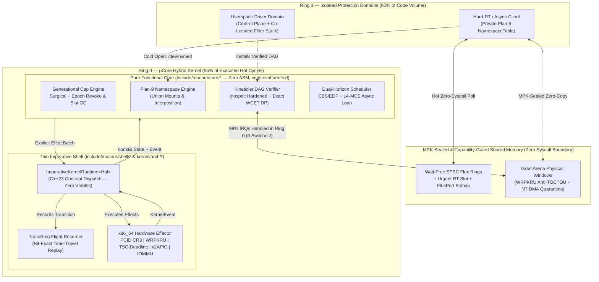

# μCore (`mucore-kernel`)

> **A Pragmatic Hybrid Real-Time C++23 Kernel Synthesizing *Zircon*, *Windows NT*, *Plan 9*, and *L4 MCS* Around a Pure *Functional Core, Imperative Shell* Architecture.**

[](#the-no-hidden-mechanisms-c23-manifesto)
[](#repository-structure)
[](#1-functional-core-imperative-shell-fcis-in-ring-0)

---

## Philosophical Vision: The Four-Lineage Balance

Operating system design has historically splintered into isolated camps—monolithic speed (Linux), async enterprise layering (Windows NT), radical namespace composability (Plan 9), capability handle discipline (Zircon), and microkernel minimalism + real-time rigor (L4 / seL4 MCS).

**μCore (`mucore-kernel`)** refuses ideological absolutism. Instead, it treats Ring 0 and Ring 3 as a **thermally adaptive, capability-governed continuum**:

* **95% of code by volume** (PCIe enumeration, device setup, fault recovery, protocol policy—executed *rarely*, where ~90% of bugs hide) runs isolated in **unprivileged Ring 3**.
* **95% of executed cycles by frequency** (IRQ filtering/acknowledgement, descriptor ring steering, readiness multiplexing, scheduler dispatch) runs in **Ring 0** or **zero-syscall shared-memory rings** with **zero context switches**.

### What μCore Synthesizes From Its Four Ancestors

| Lineage | Architectural Concept Adopted in μCore | Subsystem Implementation |
| :--- | :--- | :--- |
| **Zircon (Fuchsia)** | **`FluxPort` $O(1)$ Readiness Multiplexing + Pure Capability Discipline:** Zero ambient global VFS in Ring 0 (eliminating Confused Deputy dual-authority); bitmap-coalesced `FluxPort` lets 1 server handle $N$ SPSC client rings in exact $O(1)$ (`ctz64`) without polling empty rings. | `include/mucore/core/port.hpp` & `capability.hpp` |
| **Windows NT** | **MPK Buffer Sealing, IOMMU DMA Crash Quarantine & Co-Located Stacks:** Zero-copy `GrantArena` transfers seal sender write permissions via x86 `WRPKRU` (0 TLB shootdowns, 0 TOCTOU double-fetch races); process crashes quarantine active PCIe DMA pages until hardware drains; trusted stages co-locate in 0-IPC `ColocatedPipeline`s with reverse IRP-style cancellation. | `include/mucore/core/memory.hpp` |
| **Plan 9** | **Per-Domain Capability Namespaces ("9P-over-Flux"):** Every domain owns a private mount table mapping paths (`/dev/nvme0`) to `FluxConduit` capabilities with Plan 9 union mounts (`Before`/`After`/`Replace`). Cold opens enjoy transparent proxy interposition; `FastPromote` capabilities upgrade directly to zero-switch `Hot` rings. | `include/mucore/core/namespace_p9.hpp` |
| **L4 (seL4 MCS)** | **CBS Deadline & Budget Donation Over Async Rings:** Urgent-RT `Flux` submissions atomically loan the caller's Constant Bandwidth Server (CBS) deadline and remaining budget to the awakened Userspace Driver worker—eliminating async priority inversion while strictly conserving total EDF bandwidth. | `include/mucore/core/scheduler.hpp` |

---

## Resolving Fundamental Architectural Tensions (Design Audit)

Combining *Ring-0 hot paths*, *Userspace drivers*, *Minimal context switching*, *Async/non-blocking I/O*, *Capabilities*, *Hard Real-Time*, and *C++ Functional Core / Imperative Shell* introduces **six classical computer-science contradictions**. μCore resolves each explicitly:

1. **"Hot Paths in Ring 0" vs. "Userspace Drivers" vs. "Minimal Context Switching"**
   * **Split-Plane Drivers & Verified *Kineticlets*:** Drivers keep complex control planes in Ring 3 and graft compact, statically verified **Directed Acyclic Graph (DAG)** programs (*Kineticlets*) into Ring 0. Common-case interrupts (`99%+`) complete in Ring 0 with **0 context switches**; hardware anomalies return `EscalateToUserspace` to wake Ring 3.
2. **"Zero-Copy Shared Memory" vs. "TOCTOU Double-Fetch & Async Crash DMA Use-After-Free"**
   * **MPK `WRPKRU` Sealing + NT Quarantine:** `transfer_arena_lease` emits `UpdateProtectionKey` (`WRPKRU` revokes sender writes in ~20 cycles without cross-core `invlpg` TLB shootdowns). If a client crashes mid-DMA, `DomainCrashTeardown` places in-flight arenas into `QuarantinedDmaDrain` until hardware queues finish draining.
3. **"Wait-Free SPSC Rings" vs. "$O(N)$ Multi-Client Server Polling"**
   * **`FluxPort` Bitmap Coalescing:** Wait-Free SPSC rings guarantee $O(1)$ contention-free enqueue, while `FluxPort` aggregates readiness into `urgent_ready_bitmap` and `normal_ready_bitmap` words so servers wake and pop active rings in $O(1)$.
4. **"Asynchronous Decoupled Rings" vs. "Hard Real-Time Priority Inheritance"**
   * **L4-MCS Async Context Donation:** `donate_cbs_context()` transfers the urgent caller's `abs_deadline` and `remaining_budget_ns` to the target server worker (even if the worker is normally a non-RT Tier-1 thread!), returning unspent nanoseconds upon `FluxComplete`.
5. **"Plan 9 Human Composability" vs. "Binary Shared-Memory Speed"**
   * **"Plan 9 Cold, Zero-Switch Hot":** Discovery uses human-readable per-domain capability paths (`ns::resolve_path`). Supervisors can interpose tracing/quota proxies transparently via `MountOrder::Before` (stripping `CapRights::FastPromote`), and revoking the proxy capability in $O(1)$ automatically falls back through the union to the direct `Hot` ring.
6. **"Capability Security" vs. "The L4 Usability & Revocation Trap"**
   * **Dual-Granularity $O(1)$ Revocation + Lazy Zombie GC:** Intra-domain private RAM/futexes use `AmbientProfile` quotas (no manual 4-level page-table capability juggling). Cross-domain capabilities support *both* surgical single-slot revocation (`plan_revoke_single`, zero sibling blast radius) and subtree epoch revocation (`plan_revoke_lineage`), with automatic $O(1)$ lazy reclamation of expired zombie slots.

---

## System Architecture



---

## The "No Hidden Mechanisms" C++23 Manifesto

Every line of `mucore-kernel` adheres to strict mechanical transparency enforced by compiler flags and linker assertions:

* **No Exceptions (`-fno-exceptions`) & No RTTI (`-fno-rtti`):** Fallible operations return `[[nodiscard]] Result<T, Error>` or `Option<T>`.
* **No Vtables:** Hardware polymorphism uses `concept HalPlatform` static templates.
* **No Hidden Global Constructors (`constinit` + Linker `ASSERT`):** `kernel/arch/x86_64/linker.ld` asserts `SIZEOF(.init_array) == 0`.
* **No Hidden Heap Allocations or Struct `memcpy`s:** Bounded inline containers (`StaticVec<T, N>`) and state tables (`KernelState`, `CapTable`, `SchedTable`, `NamespaceTable`) delete implicit copy constructors (`= delete`).
* **Spectre v1 Speculative Hardening:** Ring-0 Kineticlet array/register indexing uses branchless ALU bitmasking (`nospec_index_pow2`).
* **Strict Hardware `W^X` ELF Segments:** `.text` (`R-X`), `.rodata` (`R--`), and `.data`/`.bss` (`RW-`) are isolated on 4 KiB page boundaries.

---

## Repository Structure

```text
mucore-kernel/
├── include/mucore/
│   ├── types.hpp                  # Strong IDs, ctz64, branchless Spectre-v1 nospec & Error enum
│   ├── result.hpp                 # [[nodiscard]] constexpr Option<T> & Result<T, Error>
│   ├── array_vec.hpp              # Zero-heap Span<T> & move-only StaticVec<T, Capacity>
│   ├── core/                      # === PURE FUNCTIONAL CORE (Zero ASM, 100% Host & consteval Testable) ===
│   │   ├── capability.hpp         # Surgical + Epoch O(1) revocation, Zombie Slot GC & Zircon discipline
│   │   ├── port.hpp               # Zircon/NT-inspired FluxPort O(1) multi-conduit readiness bitmap
│   │   ├── namespace_p9.hpp       # Plan 9 per-domain capability mount tables & union interposition
│   │   ├── flux.hpp               # Wait-free SPSC protocol, Urgent RT slot & Thermal Tiering
│   │   ├── kinetic.hpp            # Spectre-hardened Ring-0 Kineticlet DAG verifier (WCET DP) & VM
│   │   ├── scheduler.hpp          # Dual-Horizon CBS/EDF + L4-MCS async CBS context donation
│   │   ├── memory.hpp             # MPK sealing, NT IOMMU DMA crash quarantine & colocated stacks
│   │   ├── effects.hpp            # Algebraic KernelEvent inputs & KernelEffect hardware outputs
│   │   └── dispatcher.hpp         # Unified deterministic kernel transition engine
│   └── shell/                     # === IMPERATIVE SHELL INTERFACES ===
│       ├── hal.hpp                # Zero-vtable `concept HalPlatform` & ImperativeKernelRuntime<Hal>
│       ├── shared_conduit.hpp     # Cache-line aligned (__atomic acquire/release) wait-free SPSC ring
│       └── trace_ring.hpp         # Lock-free Flight Recorder with deterministic time-travel replay
├── kernel/                        # === BARE-METAL RING-0 IMPLEMENTATION ===
│   ├── kmain.cpp                  # constinit Ring-0 bootstrap, Limine handoff & boot POST self-check
│   └── arch/x86_64/
│       ├── boot.S                 # 64-bit Higher-Half _start, GDT/TSS reload & fast SYSCALL/SYSRETQ
│       ├── cpu.hpp                # SYSRET-ordered GDT, TSS, WRPKRU MPK seal & PCID CR3_NOFLUSH
│       ├── hal_x86_64.hpp         # Bare-metal x86_64 HalPlatform (x2APIC, TSC-Deadline, PKRU, PCID)
│       ├── limine_proto.hpp       # Standalone Limine boot protocol request definitions
│       ├── linker.ld              # Higher-half (-2 GiB) W^X ELF64 linker script (.init_array banned!)
│       └── serial.hpp             # Early 16550 UART (COM1) diagnostic console
├── tests/                         # === COMPILE-TIME PROOFS & HOST SIMULATION SUITE ===
│   ├── constexpr_proofs.cpp       # 6 consteval static_assert theorem suites verified inside compiler
│   └── test_main.cpp              # 9 end-to-end runtime verification & Four-Lineage synthesis tests
└── Makefile                       # Builds bare-metal ELF64 kernel (`make kernel`) & suite (`make test`)
```

---

## Building & Running Verification

```bash
# Build freestanding x86_64 ELF64 kernel + run all compile-time & host suites (GCC or Clang)
make all
make CXX=clang++ all
```

### Verification Output
```text
======================================================================
  μCore (mucore-kernel) — FCIS & Four-Lineage Verification Suite
  Compile-Time `static_assert` Proofs (6 Theorem Suites): PASSED
======================================================================
[TEST 1] Capabilities: Monotonicity, Surgical + Epoch Revoke & Slot GC...
  [PASS] Surgical + O(1) epoch revocation & zombie slot GC verified.
[TEST 2] Wait-Free SPSC Shared Ring & Urgent RT Fast-Lane...
  [PASS] Wait-free SPSC & Urgent RT head-of-line preemption verified.
[TEST 3] Adaptive Conduit Thermal Promotion & Hysteresis Decay...
  [PASS] Adaptive Thermal Tiering promotes hot paths & parks idle channels.
[TEST 4] Split-Plane Userspace Driver + Ring-0 Kineticlet (100 IRQs)...
  [PASS] 99/100 IRQs completed in Ring 0 (0 switches, WCET=38 ns); replay verified!
[TEST 5] Hard Real-Time CBS Temporal Isolation Under IRQ Storm...
  [PASS] CBS budget charging protects sibling Hard-RT deadlines.
[TEST 6] Zircon Synthesis: FluxPort O(1) Readiness Aggregator (24 Conduits)...
  [PASS] Server serviced 2 active clients out of 24 in O(1) with 0 empty-ring scans.
[TEST 7] Plan 9 Synthesis: Per-Domain Namespaces & Union Interposition...
  [PASS] Plan 9 capability mounts, union interposition & live fallback verified.
[TEST 8] Windows NT Synthesis: MPK Seal, DMA Crash Quarantine & Colocation...
  [PASS] MPK anti-TOCTOU seal, IOMMU DMA crash quarantine & colocation verified.
[TEST 9] L4-MCS Synthesis: CBS Deadline & Budget Donation Over Async Flux...
  [PASS] Async priority inversion eliminated with exact CBS budget conservation.
----------------------------------------------------------------------
Summary: 9 passed, 0 failed.
```

---

## Roadmap

- [x] **Phase 0 — Foundational FCIS Groundwork:** Explicit C++23 FCIS architecture, Generational Capabilities, Wait-Free `Flux` Conduits, Verified Ring-0 `Kineticlet` DAGs, CBS/EDF Tickless Scheduler, `TraceRing` replay, and Higher-Half `x86_64` W^X ELF64 bootstrap.
- [x] **Phase 1 — The Four-Lineage Synthesis (Current):** Zircon `FluxPort` $O(1)$ multiplexing, Plan 9 per-domain capability union namespaces (`namespace_p9.hpp`), Windows NT MPK `WRPKRU` anti-TOCTOU sealing + IOMMU DMA crash quarantine + co-located pipelines, L4-MCS async CBS deadline/budget donation, surgical revocation + zombie slot GC, and Spectre-v1 `nospec` Kineticlet hardening.
- [ ] **Phase 2 — Hardware Paging, SMP Sharding & Bootable Limine ISO:** 4/5-level HHDM page-table builder (`VmSpace`), per-CPU sharded Functional Core state with cross-core wait-free mailrouting, IDT exception vectors, and `make iso` / `make qemu`.
- [ ] **Phase 3 — Ring-3 Protection Domains & VT-d / AMD-Vi IOMMU:** First Ring-3 Userspace Driver ELF host, dual-mapped `SharedSpscRing` pages, and hardware IOMMU table programming.
- [ ] **Phase 4 — Native x86_64 Machine-Code Compiler for Kineticlets:** Ahead-of-time lowering of verified `KineticProgram` DAGs to native `x86_64` instructions (< 5 ns Ring-0 execution).
