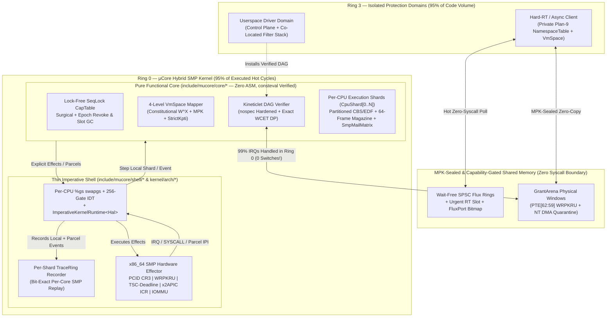

# μCore (`mucore-kernel`)

> **A Pragmatic Hybrid Real-Time SMP C++23 Kernel Synthesizing *Zircon*, *Windows NT*, *Plan 9*, and *L4 MCS* Around a Pure *Functional Core, Imperative Shell* Architecture.**

[](#the-no-hidden-mechanisms-c23-manifesto)
[](#repository-structure)
[](#system-architecture)
[](LICENSE)

---

## Philosophical Vision: The Four-Lineage Balance

Operating system design has historically splintered into isolated camps—monolithic speed (Linux), async enterprise layering (Windows NT), radical namespace composability (Plan 9), capability handle discipline (Zircon), and microkernel minimalism + real-time rigor (L4 / seL4 MCS).

**μCore (`mucore-kernel`)** refuses ideological absolutism. Instead, it treats Ring 0 and Ring 3 as a **thermally adaptive, capability-governed continuum**:

* **95% of code by volume** (PCIe enumeration, device setup, fault recovery, protocol policy—executed *rarely*, where ~90% of bugs hide) runs isolated in **unprivileged Ring 3**.
* **95% of executed cycles by frequency** (IRQ filtering/acknowledgement, descriptor ring steering, readiness multiplexing, scheduler dispatch) runs in **Ring 0** or **zero-syscall shared-memory rings** with **zero context switches**.

### What μCore Synthesizes From Its Four Ancestors

| Lineage | Architectural Concept Adopted in μCore | Subsystem Implementation |
| :--- | :--- | :--- |
| **Zircon (Fuchsia)** | **`FluxPort` $O(1)$ Readiness Multiplexing + Pure Capability Discipline:** Zero ambient global VFS in Ring 0 (eliminating Confused Deputy dual-authority); bitmap-coalesced `FluxPort` lets 1 server handle $N$ SPSC client rings in exact $O(1)$ (`ctz64`) without polling empty rings. | `include/mucore/core/port.hpp` & `capability.hpp` |
| **Windows NT** | **MPK Buffer Sealing, IOMMU DMA Crash Quarantine & Co-Located Stacks:** Zero-copy `GrantArena` transfers seal sender write permissions via x86 `WRPKRU` (0 TLB shootdowns, 0 TOCTOU double-fetch races); process crashes quarantine active PCIe DMA pages until hardware drains; trusted stages co-locate in 0-IPC `ColocatedPipeline`s with reverse IRP-style cancellation. | `include/mucore/core/memory.hpp` |
| **Plan 9** | **Per-Domain Capability Namespaces ("9P-over-Flux"):** Every domain owns a private mount table mapping paths (`/dev/nvme0`) to `FluxConduit` capabilities with Plan 9 union mounts (`Before`/`After`/`Replace`). Cold opens enjoy transparent proxy interposition; `FastPromote` capabilities upgrade directly to zero-switch `Hot` rings. | `include/mucore/core/namespace_p9.hpp` |
| **L4 (seL4 MCS)** | **CBS Deadline & Budget Donation Over Async Rings & SMP:** Urgent-RT `Flux` submissions atomically loan the caller's Constant Bandwidth Server (CBS) deadline and remaining budget to the awakened Userspace Driver worker—locally or across cores via wait-free `DonateRemoteCbs` IPI parcels—strictly conserving total EDF bandwidth. | `include/mucore/core/scheduler.hpp` & `smp.hpp` |

---

## Resolving Fundamental Architectural Tensions (Design Audit)

Combining *Ring-0 hot paths*, *Userspace drivers*, *Minimal context switching*, *Async/non-blocking I/O*, *Capabilities*, *Hard Real-Time*, *Multi-Core SMP*, and *C++ Functional Core / Imperative Shell* introduces **seven classical computer-science contradictions**. μCore resolves each explicitly:

1. **"Hot Paths in Ring 0" vs. "Userspace Drivers" vs. "Minimal Context Switching"**
   * **Split-Plane Drivers & Verified *Kineticlets*:** Drivers keep complex control planes in Ring 3 and graft compact, statically verified **Directed Acyclic Graph (DAG)** programs (*Kineticlets*) into Ring 0. Common-case interrupts (`99%+`) complete in Ring 0 with **0 context switches**; hardware anomalies return `EscalateToUserspace` to wake Ring 3.
2. **"Zero-Copy Shared Memory" vs. "TOCTOU Double-Fetch & Async Crash DMA Use-After-Free"**
   * **MPK `WRPKRU` Sealing + NT Quarantine:** `transfer_arena_lease` emits `UpdateProtectionKey` (`WRPKRU` revokes sender writes in ~20 cycles without cross-core `invlpg` TLB shootdowns). If a client crashes mid-DMA, `DomainCrashTeardown` places in-flight arenas into `QuarantinedDmaDrain` until hardware queues finish draining.
3. **"Wait-Free SPSC Rings" vs. "$O(N)$ Multi-Client Server Polling"**
   * **`FluxPort` Bitmap Coalescing:** Wait-Free SPSC rings guarantee $O(1)$ contention-free enqueue, while `FluxPort` aggregates readiness into `urgent_ready_bitmap` and `normal_ready_bitmap` words so servers wake and pop active rings in $O(1)$.
4. **"Asynchronous Decoupled Rings" vs. "Hard Real-Time Priority Inheritance"**
   * **L4-MCS Async Context Donation:** `donate_cbs_context()` transfers the urgent caller's `abs_deadline` and `remaining_budget_ns` to the target server worker (even if the worker is normally a non-RT Tier-1 thread!), returning unspent nanoseconds upon `FluxComplete`.
5. **"Plan 9 Human Composability" vs. "Binary Shared-Memory Speed"**
   * **"Plan 9 Cold, Zero-Switch Hot":** Discovery uses human-readable per-domain capability paths (`ns::resolve_path`). Supervisors can interpose tracing/quota proxies transparently via `MountOrder::Before` (stripping `CapRights::FastPromote`), and revoking the proxy capability in $O(1)$ automatically falls back through the union to the direct `Hot` ring.
6. **"Capability Security" vs. "The L4 Usability & Revocation Trap"**
   * **Dual-Granularity $O(1)$ Revocation + Lazy Zombie GC:** Intra-domain private RAM/futexes use `AmbientProfile` quotas (no manual 4-level page-table capability juggling). Cross-domain capabilities support *both* surgical single-slot revocation (`plan_revoke_single`, zero sibling blast radius) and subtree epoch revocation (`plan_revoke_lineage`), with automatic $O(1)$ lazy reclamation of expired zombie slots.
7. **"Multi-Core SMP Parallelism" vs. "Pure Deterministic FCIS & Hard-RT WCET"**
   * **Hybrid SMP Sharding (`SmpNodeState`):** Rather than putting a global lock around `KernelState` (destroying Hard-RT WCET) or duplicating every capability across cores (like pure multikernel Barrelfish), μCore **shards hot execution** (`CpuShard`: cache-line-aligned per-core `SchedTable`, 64-frame `LocalFrameMagazine`, and `ShardTraceRing`) while keeping `CapTable` **read-lockless** via an acquire/release generation SeqLock. Cross-core L4-MCS CBS loans travel over an $N \times N$ wait-free `SharedSpscRing<CrossCoreParcel, 16>` matrix, and recording incoming parcels in each core's `ShardTraceRing` preserves **bit-exact single-core deterministic replay**!

---

## Hybrid SMP Sharding, 4-Level `VmSpace` & Hardware Isolation (Phase 2)

* **Partitioned CBS/EDF + Cross-Core IPI Loans (`smp.hpp`):** Tier-0 `IsochronousRt` threads are core-pinned so per-core $\sum C_i / T_i \le 0.85$ CBS admission guarantees remain exact. Cross-core RT driver calls ship `DonateRemoteCbs` and `RefundRemoteCbs` parcels wait-free without ever locking a remote runqueue; Tier-1 `AsyncThroughput` threads support `MigrateAsyncThread` rebalancing.
* **Active-Core Bitmask + Targeted `PKRU` Coherence:** `domain_active_cpus[domain]` tracks which cores currently host threads of a domain. Sealing a `GrantArena` when 1 core runs the domain executes local `WRPKRU` with **0 IPIs**; when multiple cores run sibling threads, `SyncPkruSeal` parcels and x2APIC IPIs (`MSR_X2APIC_ICR`) target **only** those sibling cores.
* **4-Level `VmSpace` Paging (`vmspace.hpp`):** Enforces constitutional hardware `W^X` (`Error::WxorXViolation`), encodes 4-bit MPK keys in `PTE[62:59]`, shares `Global` higher-half `PML4[256..511]` by default (`KptiMode::SharedHigherHalf`, 0 CR3 switch on `SYSCALL`/IRQ), and offers per-domain `KptiMode::StrictKpti` opt-in for untrusted sandboxes.
* **Per-Core Physical Frame Magazines (`memory.hpp`):** Each `CpuShard` caches 64 physical 4 KiB frames (`LocalFrameMagazine`, 32-frame batch refills under fair `ColdTicketLock`). `RT_EMERGENCY_WATERMARK = 8` reserves the last 8 frames exclusively for Tier-0 Hard-RT paths (`Error::RtReserveProtected`).
* **Bare-Metal `x86_64` SMP Bootstrap (`percpu.hpp`, `idt.hpp`, `boot.S`, `kmain.cpp`):** Per-CPU `%gs` (`swapgs` on `SYSCALL` and conditional `CS & 3` `swapgs` on interrupts), per-CPU GDT/64-bit TSS + dedicated `IST=1` Double-Fault stacks, 256-gate IDT (`#DF`, `#GP`, `#PF` + `%cr2`, `VEC_APIC_TIMER`, `VEC_SMP_PARCEL_IPI`), and Limine SMP x2APIC Application Processor (AP) bring-up.

---

## System Architecture



---

## The "No Hidden Mechanisms" C++23 Manifesto

Every line of `mucore-kernel` adheres to strict mechanical transparency enforced by compiler flags and linker assertions:

* **No Exceptions (`-fno-exceptions`) & No RTTI (`-fno-rtti`):** Fallible operations return `[[nodiscard]] Result<T, Error>` or `Option<T>`.
* **No Vtables:** Hardware polymorphism uses `concept HalPlatform` static templates.
* **No Hidden Global Constructors (`constinit` + Linker `ASSERT`):** `kernel/arch/x86_64/linker.ld` asserts `SIZEOF(.init_array) == 0`.
* **No Hidden Heap Allocations or Struct `memcpy`s:** Bounded inline containers (`StaticVec<T, N>`) and state tables (`KernelState`, `SmpNodeState`, `CapTable`, `SchedTable`, `NamespaceTable`) delete implicit copy constructors (`= delete`).
* **Spectre v1 Speculative Hardening & Data-Race Freedom:** Ring-0 Kineticlet indexing uses branchless ALU bitmasking (`nospec_index_pow2`); concurrent SMP structures pass Clang ThreadSanitizer (`-fsanitize=thread`) with zero warnings.
* **Strict Hardware `W^X` ELF Segments:** `.text` (`R-X`), `.rodata` (`R--`), and `.data`/`.bss` (`RW-`) are isolated on 4 KiB page boundaries.

---

## Repository Structure

```text
mucore-kernel/
├── boot/
│   └── limine.conf                # Limine v8+ bootloader configuration for mucore-x86_64.elf
├── include/mucore/
│   ├── types.hpp                  # Strong IDs (CpuId, PkeyId...), ctz64, popcount64, nospec & Error
│   ├── result.hpp                 # [[nodiscard]] constexpr Option<T> & Result<T, Error>
│   ├── array_vec.hpp              # Zero-heap Span<T> & move-only StaticVec<T, Capacity>
│   ├── core/                      # === PURE FUNCTIONAL CORE (Zero ASM, 100% Host & consteval Testable) ===
│   │   ├── capability.hpp         # Lock-free SMP SeqLock validation, Surgical + Epoch revoke & Slot GC
│   │   ├── port.hpp               # Zircon/NT-inspired FluxPort O(1) multi-conduit readiness bitmap
│   │   ├── namespace_p9.hpp       # Plan 9 per-domain capability mount tables & union interposition
│   │   ├── flux.hpp               # Wait-free SPSC protocol, Urgent RT slot & Thermal Tiering
│   │   ├── kinetic.hpp            # Spectre-hardened Ring-0 Kineticlet DAG verifier (WCET DP) & VM
│   │   ├── scheduler.hpp          # Partitioned CBS/EDF + Local & Cross-Core L4-MCS CBS context loans
│   │   ├── memory.hpp             # Per-core Magazines (RT watermark), MPK seal, NT DMA quarantine
│   │   ├── vmspace.hpp            # 4-level x86_64 VmSpace mapper (W^X, MPK PTE[62:59], StrictKpti)
│   │   ├── smp.hpp                # Per-CPU CpuShard, wait-free SmpMailMatrix, targeted PKRU & replay
│   │   ├── effects.hpp            # Algebraic KernelEvent inputs & KernelEffect hardware outputs
│   │   └── dispatcher.hpp         # Unified deterministic kernel transition engine
│   └── shell/                     # === IMPERATIVE SHELL INTERFACES ===
│       ├── hal.hpp                # Zero-vtable `concept HalPlatform` & ImperativeKernelRuntime<Hal>
│       ├── shared_conduit.hpp     # Cache-line aligned (__atomic acquire/release) wait-free SPSC ring
│       └── trace_ring.hpp         # Lock-free Flight Recorder with deterministic time-travel replay
├── kernel/                        # === BARE-METAL RING-0 SMP IMPLEMENTATION ===
│   ├── kmain.cpp                  # constinit Ring-0 BSP + Limine SMP AP bring-up & POST self-check
│   └── arch/x86_64/
│       ├── boot.S                 # Multi-core swapgs SYSCALL/SYSRETQ & 16B-aligned IDT ISR stubs
│       ├── cpu.hpp                # SYSRET-ordered GDT, TSS, WRPKRU, x2APIC ICR IPI & PCID CR3
│       ├── percpu.hpp             # Per-CPU %gs block, Ring-0 & IST1 stacks, GDT/TSS per core
│       ├── idt.hpp                # 256-gate 64-bit IDT (#DF IST1, #GP, #PF, APIC Timer & SMP IPI)
│       ├── hal_x86_64.hpp         # Bare-metal x86_64 HalPlatform (x2APIC, TSC-Deadline, PKRU, PCID)
│       ├── limine_proto.hpp       # Standalone Limine HHDM, Memmap & SMP x2APIC protocol requests
│       ├── linker.ld              # Higher-half (-2 GiB) W^X ELF64 linker script (.init_array banned!)
│       └── serial.hpp             # Early 16550 UART (COM1) diagnostic console
├── tests/                         # === COMPILE-TIME PROOFS & CONCURRENT SMP SIMULATION SUITE ===
│   ├── constexpr_proofs.cpp       # 9 consteval static_assert theorem suites verified inside compiler
│   └── test_main.cpp              # 11 runtime suites including 4-OS-thread SMP sharding & replay
└── Makefile                       # Builds bare-metal SMP ELF64 (`make kernel`) & suite (`make test`)
```

---

## Building & Running Verification

```bash
# Build freestanding x86_64 SMP ELF64 kernel + run all compile-time & 4-thread SMP suites
make all
make CXX=clang++ all
```

### Verification Output
```text
======================================================================
  μCore (mucore-kernel) — FCIS, Four-Lineage & SMP Verification Suite
  Compile-Time `static_assert` Proofs (9 Theorem Suites): PASSED
======================================================================
[TEST 1] Capabilities: Monotonicity, Surgical + Epoch Revoke & Slot GC...
  [PASS] Surgical + O(1) epoch revocation & zombie slot GC verified.
[TEST 2] Wait-Free SPSC Shared Ring & Urgent RT Fast-Lane...
  [PASS] Wait-free SPSC & Urgent RT head-of-line preemption verified.
[TEST 3] Adaptive Conduit Thermal Promotion & Hysteresis Decay...
  [PASS] Adaptive Thermal Tiering promotes hot paths & parks idle channels.
[TEST 4] Split-Plane Userspace Driver + Ring-0 Kineticlet (100 IRQs)...
  [PASS] 99/100 IRQs completed in Ring 0 (0 switches, WCET=38 ns); replay verified!
[TEST 5] Hard Real-Time CBS Temporal Isolation Under IRQ Storm...
  [PASS] CBS budget charging protects sibling Hard-RT deadlines.
[TEST 6] Zircon Synthesis: FluxPort O(1) Readiness Aggregator (24 Conduits)...
  [PASS] Server serviced 2 active clients out of 24 in O(1) with 0 empty-ring scans.
[TEST 7] Plan 9 Synthesis: Per-Domain Namespaces & Union Interposition...
  [PASS] Plan 9 capability mounts, union interposition & live fallback verified.
[TEST 8] Windows NT Synthesis: MPK Seal, DMA Crash Quarantine & Colocation...
  [PASS] MPK anti-TOCTOU seal, IOMMU DMA crash quarantine & colocation verified.
[TEST 9] L4-MCS Synthesis: CBS Deadline & Budget Donation Over Async Flux...
  [PASS] Async priority inversion eliminated with exact CBS budget conservation.
[TEST 10] VmSpace 4-Level Paging (W^X, MPK, StrictKpti) & Magazines...
  [PASS] 4-level VmSpace W^X/MPK/StrictKpti & Hard-RT Magazine reserve verified.
[TEST 11] 4-OS-Thread SMP Sharding, CBS IPI Loans, PKRU & Per-Core Replay...
  [PASS] 4-thread SMP sharding, 160 magazine allocs, targeted PKRU & 4-core replay verified!
----------------------------------------------------------------------
Summary: 11 passed, 0 failed.
```

---

## Roadmap

- [x] **Phase 0 — Foundational FCIS Groundwork:** Explicit C++23 FCIS architecture, Generational Capabilities, Wait-Free `Flux` Conduits, Verified Ring-0 `Kineticlet` DAGs, CBS/EDF Tickless Scheduler, `TraceRing` replay, and Higher-Half `x86_64` W^X ELF64 bootstrap.
- [x] **Phase 1 — The Four-Lineage Synthesis:** Zircon `FluxPort` $O(1)$ multiplexing, Plan 9 per-domain capability union namespaces (`namespace_p9.hpp`), Windows NT MPK `WRPKRU` anti-TOCTOU sealing + IOMMU DMA crash quarantine + co-located pipelines, L4-MCS async CBS deadline/budget donation, surgical revocation + zombie slot GC, and Spectre-v1 `nospec` Kineticlet hardening.
- [x] **Phase 2 — Hybrid SMP Sharding, 4-Level `VmSpace` & Multi-Core Hardware Bootstrap (Current):** Per-CPU `CpuShard`s, wait-free `SmpMailMatrix` cross-core CBS loans, active-core targeted `PKRU` shootdowns, 4-level `VmSpace` (`W^X` + MPK + `StrictKpti`), 64-frame per-core magazines with Hard-RT watermark, `%gs` `swapgs` + 256-gate IDT + Limine SMP AP bring-up, and 4-OS-thread deterministic SMP replay.
- [ ] **Phase 3 — Ring-3 Protection Domains & VT-d / AMD-Vi IOMMU:** First Ring-3 Userspace Driver ELF host, dual-mapped `SharedSpscRing` pages, and hardware IOMMU table programming.
- [ ] **Phase 4 — Native x86_64 Machine-Code Compiler for Kineticlets:** Ahead-of-time lowering of verified `KineticProgram` DAGs to native `x86_64` instructions (< 5 ns Ring-0 execution).

---

## License & Trademark Notice

### License
This project is open-source software licensed under the [MIT License](LICENSE).

### Trademark Notice & Legal Disclaimers
All product names, logos, brands, trademarks, and registered trademarks mentioned in this repository (including "Zircon", "Fuchsia", "Windows", "Windows NT", "Plan 9", "L4", "seL4", "Linux", "Limine", "Intel", "AMD", etc.) are the property of their respective owners. Their use in this documentation and codebase is strictly for identification, historical reference, and architectural comparison under nominative fair use.

μCore (`mucore-kernel`) is an independent, clean-room software project written from scratch and is not affiliated with, endorsed by, or sponsored by Google, Microsoft, Bell Labs, the seL4 Foundation, or any other trademark holders. μCore is likewise distinct and independent from the educational Tsinghua `ucore` operating system.
